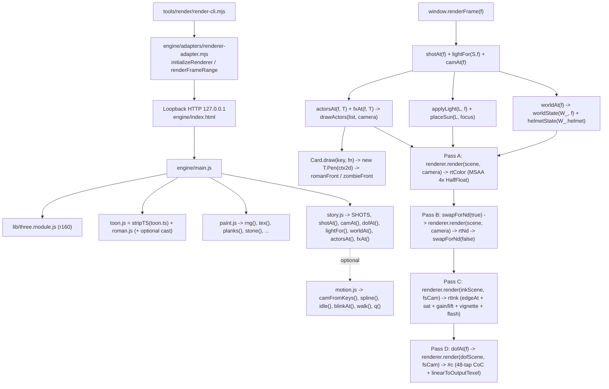

# Cartoon Short Renderer — Source & Runtime Architecture (`SHORT-01`)

## 1. Original Engine Modules

The supplied `cartoon-short-kit` engine consists of five browser ES modules / HTML files plus external Three.js and `toon.ts`:

- `engine/index.html` (`361` B): Hosts `<canvas id="c" width="1080" height="1920"></canvas>`, registers a global `error` listener (`window.err`), and loads `main.js` as an ES module.
- `engine/main.js` (`31,418` B): Initializes `THREE.WebGLRenderer`, 2-step `MeshToonMaterial` gradient lookup, procedural textures, 3D world meshes, 2D `Card` character/FX billboards, 3 offscreen `HalfFloatType` render targets (`rtColor`, `rtNd`, `rtInk`), screen-space ink + color-grade shader (`inkScene`), 48-tap Depth-of-Field shader (`dofScene`), and `window.renderFrame(f)`.
- `engine/paint.js` (`11,477` B): Seeded LCG PRNG (`rng(seed)`) and deterministic 2D canvas texture generators (`planks`, `beam`, `rotten`, `stone`, `mossy`, `grass`, `dirt`, `plaster`, `roof`, `marble`, `banner`, `helmetInside`, `radial`) wrapped via `tex()` into `THREE.CanvasTexture` (`SRGBColorSpace`).
- `engine/motion.js` (`3,826` B): Easing functions (`M.smooth`, `easeOut`, `easeIn`, `back`, `anticip`, `spring`), Catmull-Rom 3D `spline()`, `camFromKeys()`, deterministic character `idle(f, seed)`, `blinkAt(f, seed)`, `walk(f, f0, speed, stride)`, and pose quantization `q(x, n)`.
- `engine/roman.js` (`18,980` B): Adds `FACE` expressions (`snore`, `stubborn`, `squint`), `OUTFITS`, `romanFront()`, `helmetCard()`, `headCenter()`, and 2D FX drawers (`fxZ`, `fxLeaf`, `fxDust`, `fxDrip`, `fxWood`) on top of `mromidev/claude-animated-shorts` (`templates/bridge/toon.ts`).

---

## 2. Runtime Dependency Graph & Real Function Call Diagram

---

## 3. Scene Initialization

On module evaluation, `main.js` creates:
- `WebGLRenderer({ canvas, antialias: false, preserveDrawingBuffer: true })` sized to `1080 × 1920` (`pixelRatio = 1`, `PCFSoftShadowMap`, `SRGBColorSpace`, `NoToneMapping`).
- `PerspectiveCamera(40, 1080 / 1920, 0.08, 1500)`.
- `grad`: 2×1 `NearestFilter` `DataTexture` (`[90, 90, 90, 255, 255, 255, 255, 255]`) driving 2-band cel shading across all `MeshToonMaterial` surfaces.
- Sky dome (`SphereGeometry(1200)` with `BackSide` custom shader), `HemisphereLight`, shadow-casting `DirectionalLight` (`2048×2048` shadow map), `THREE.Fog`, and 3D world geometry.
- Sets `window.TOTAL = TOTAL` and `window.ready = true` once synchronous scene construction completes.

---

## 4. Character Drawing Path

1. `story.js` `actorsAt(f, T)` and `fxAt(f, T)` return descriptor objects `{ key, draw, x, y, z, s, flip, yaw, roll, tint, alpha, shadow, blob, order }`.
2. `drawActors(list, camera)` allocates/reuses pooled `Card` instances (`1200 × 2000` offscreen 2D canvas mapped to a `1.35 m × 2.25 m` 3D plane).
3. `Card.draw(key, fn)` compares `key === this.key`; thanks to `q()` quantization, the 2D canvas is cleared and redrawn via `new T.Pen(g)` (`romanFront` or `zombieFront`) **only when the quantized pose key changes**, uploading `CanvasTexture.needsUpdate = true`.
4. Each `Card` mesh rotates around Y (`Math.atan2(cam.position.x - a.x, cam.position.z - a.z)`) to billboard toward the camera, casts shadows via an alpha-tested `customDepthMaterial` (`alphaTest: 0.5`), and places a soft radial ground contact `blob` shadow at `ground + 0.02`.

---

## 5. Camera Update Path

`camAt(f)` returns `{ pos, look, fov, roll, flash, shadowAt }` interpolated via smootherstep (`t³(t(6t - 15) + 10)`) or `motion.js` `camFromKeys()` (which adds optional 3D Catmull-Rom `spline()` via-points, hold `creep` push-in, and decaying 7-frame alternating camera `kicks`). `renderFrame(f)` sets `camera.position`, resets `camera.up` to `(0,1,0)`, calls `camera.lookAt`, applies Dutch `camera.rotateZ(rx(C.roll))`, updates `camera.fov`, and calls `updateProjectionMatrix()` + `updateMatrixWorld()`.

---

## 6. Lighting Update Path

`lightFor(S, f)` selects and modulates the shot's lighting preset (`LIGHTS[S.light]`). `applyLight(L, f)` updates hemisphere sky/ground colors, directional sun color/intensity, scene fog color/near/far, sky dome zenith/horizon/sun-disc uniforms, water colors, and color-grade uniforms (`sat`, `gain`, `lift`). `placeSun(L, focus)` computes world-space sun direction from azimuth/elevation (`L.az`, `L.el`), positions the directional light `80 m` from `focus`, and updates the orthographic shadow frustum (`±shadowExt`).

---

## 7. Normal / Depth Pass (`Pass B`)

After rendering color into `rtColor` (`samples: 4`, `HalfFloatType`), `renderFrame(f)` temporarily disables `scene.fog` and `renderer.shadowMap`, calls `swapForNd(true)`, renders into `rtNd` (`NearestFilter`, `HalfFloatType`), and restores materials via `swapForNd(false)`:
- World meshes use `ndMat`, encoding view-space normal `(n * 0.5 + 0.5)` in `RGB` and linear view depth `-mv.z` in `A`.
- Character/FX `Card` meshes use `cardNd(map)`, discarding transparent pixels (`alpha < 0.5`) and writing `(0, 0, 0, vD)` (`dot(rgb, rgb) == 0`), signaling to the ink shader that the pixel belongs to a 2D card that already has its own `#241726` drawn outline.
- Sky, clouds, and ground shadow blobs set `ndSkip` / `sky` and are hidden during `Pass B`.

---

## 8. Ink Postprocessing & Color Grading (`Pass C`)

`inkScene` samples `rtColor` and `rtNd` across a 16-tap dual-ring kernel (`edgeAt(vUv, px = 2.5)`):
- Scales kernel radius inversely with depth (`clamp(7.0 / d, 0.62, 1.25)`).
- Skips samples landing on character cards (`dot(s.rgb, s.rgb) < 0.01 && ds > 0`) so 3D world ink never double-outlines 2D character cards.
- Detects silhouette depth jumps (`smoothstep(0.006, 0.02, (ds - d) / d)`) on the near side only and normal creases (`smoothstep(0.88, 0.72, dot(n, ns)) * 0.9`), fading ink smoothly over distance (`140 m .. 520 m`).
- Blends ink color `vec3(0.012, 0.01, 0.014)`, applies luma saturation (`sat`), `gain` + `lift`, elliptical vignette (`vig`), and transition white `flash` into `rtInk`.

---

## 9. Depth-of-Field Output (`Pass D`)

`dofScene` computes signed circle-of-confusion radius `coc(uv)` from `rtNd.a` against `dofAt(f)` (`{ focus, cinf, near }`). Pixels in sharp focus (`cinf < 0.5 || coc < 0.6`) bypass blur; out-of-focus pixels accumulate a 48-tap Golden-angle spiral disc (`a = i * 2.39996`) weighted by sample CoC overlap and convert linear color to sRGB via `linearToOutputTexel()` onto `#c`.

---

## 10. Frame Encoding

`engine/adapters/renderer-adapter.mjs` (and `tools/render/render-cli.mjs`) drives Chromium over `127.0.0.1`, invokes `window.renderFrame(f)`, samples a `108×192` luminance probe to reject blank/black renders, extracts `canvas.toDataURL('image/jpeg', quality)`, validates JPEG SOI/EOI/SOF (`1080×1920`, `9:16`), and writes `f%04d.jpg` atomically.

---

## 11. Audio Timing

`tools/timing/timing_validator.py` wraps `vendor/cartoon-short-kit/tools/timing.py` (`duration`, `speech_segments`, `whisper_words`, `align`), enforcing `frames30 == round(duration * 30)`, non-negative monotonic timestamps within audio bounds, zero dropped words, and explicit `alignmentPrecision` labeling (`exact-whisper-asr` vs `approximate-silence-dp`).

---

## 12. Audio Mixing

Two explicitly separated modes are provided:
1. **Original Baseline (`--mode original-baseline`)**: Runs `example/soldier/audio.py` unmodified (envelope-follower ducking + `tanh` soft-clipper + `loudnorm`).
2. **Specification-Compliant (`tools/audio/mix.py` — NEW CODE)**: Preserves narration untouched prior to master peak safety, calibrates music and active SFX stems linearly to `-6.0 dB` gated RMS relative to narration, controls SFX transient peaks (`<= -3.0 dBFS`), applies zero ducking and zero nonlinear waveshaping, and outputs 48 kHz stereo PCM WAV with EBU R128 measurements.

---

## 13. Final Muxing

`tools/render/mux-mp4.mjs` encodes `f%04d.jpg` (`30` fps) + stereo `48 kHz` WAV to MP4 (`libx264`, `yuv420p`, `aac 192k`, `-movflags +faststart`) and verifies binary `moov`-before-`mdat` atom order, stream dimensions/codecs via `ffprobe`, EBU R128 loudness, and zero `blackdetect`/`freezedetect` anomalies.

---

## 14. QA Pipeline

`tests/run-dag.mjs` runs an 8-stage async DAG (`source-audit`, `hash-verification`, `dependency-checks`, `unit-tests` in parallel -> `engine-setup` -> single-worker `browser-smoke-and-integration` -> `regression-backtest-negative` -> `e2e-viewer-and-full-render-qa`), followed by `tools/qa/verify-gates.mjs` (`G01`–`G17`).

---

## 15. Future Studio UI Integration Contract

Defined in `app/shared/contract.mjs` and demonstrated live in `app/server/viewer-server.mjs` + `app/frontend/viewer.html`:
- **Format Lock**: Strictly `9:16` (`1080 × 1920`, `30` FPS, Three.js + 2D Pen cards). Rejects `16:9`, Skia, Remotion, and Long Renderer modes.
- **Direct Adapter Controls Available Now**: Project selection, single-frame still preview, pass inspection (`final` / `#nd` / `#e`), full frame-range render with cancellation & resume, timing alignment, linear gated-RMS mixing, QA gate evaluation, and MP4 export.
- **Requires Phase 2 Authoring Compiler**: Declarative JSON editing of `SHOTS`, `CAMS`, `LIGHTS`, `dofAt`, character pose expressions, and modular 3D scene blocks (which are currently imperative JS functions in `story.js`).
